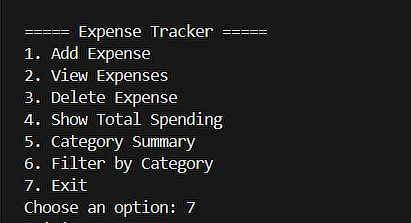
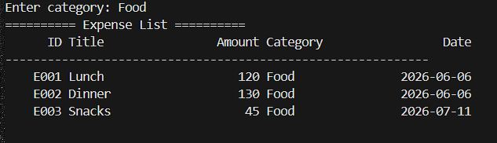

# Expense Tracker CLI

This is a Python program I made to record expenses from the terminal. I wanted to practice saving data to a file, checking inputs and splitting a project into modules.

It's fairly simple: you enter an expense, it saves to JSON, and you can view or summarize the records later.

## Features

- Add an expense with a title, amount, category and date.
- List expenses and delete one by ID.
- Show total spending.
- Get a category-wise summary or filter by category.

The amount must be a positive whole number. Dates use `YYYY-MM-DD`, and the available categories are in [`config/categories.json`](config/categories.json).

## Screenshots

| Menu | Saved expenses |
| --- | --- |
|  |  |

Category totals:



## Run it

You need Python 3. No additional packages are required.

```bash
git clone https://github.com/Rafidabd/expense-tracker-cli.git
cd expense-tracker-cli
python main.py
```

The program creates `data/expenses.json` when it's needed. That file stays in the project folder and isn't tracked by Git.

For example, an expense is stored like this:

```json
{
  "id": "E001",
  "title": "Lunch",
  "amount": 250,
  "category": "Food",
  "date": "2026-03-10"
}
```

That's an example, not a record included with the project.

## Files

```text
expense-tracker-cli/
├── assets/                  # README screenshots
├── config/categories.json   # Categories
├── modules/
│   ├── analytics.py         # Totals and filtering
│   ├── cli.py               # Menu
│   ├── config_loader.py
│   ├── display.py           # Terminal output
│   ├── expense_manager.py   # Add/delete expenses
│   └── storage.py           # JSON storage and IDs
├── tests/test_storage.py
├── main.py
└── README.md
```

One fix I made after moving this into its own repository was changing the data path. Originally it depended on where I opened the terminal. Now it uses the project folder.

## Tests

```bash
python -m unittest discover -s tests -v
```

There are three tests so far: creating an empty store, adding and deleting an expense, and rejecting an invalid amount. They use temporary files, so they won't change your expenses.

## Things I could improve

This isn't a full budgeting app. It uses local JSON, doesn't sync between devices and only accepts whole-number amounts. I'd like to improve how IDs are generated and test more invalid inputs.

I first wrote it in [my Python practice repository](https://github.com/Rafidabd/python-phase-1/tree/main/day13_Mini_Projects/expense-tracker-cli). Its earlier commits are preserved here.
